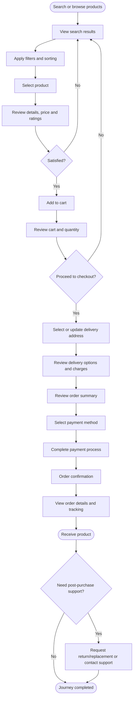

# Amazon India — AS-IS Process Flow

**Version:** 1.0 — Finalised  
**Prepared by:** Independent Business Analyst  
**Research:** Direct website exploration and personal observations

## Purpose and scope
This document describes the customer-facing journey from searching or browsing products through delivery, with optional post-purchase support. Internal warehouse, seller, courier and payment-gateway operations are outside scope.

**Start:** Customer searches or browses products.  
**Main end:** Customer receives the product.  
**Optional branch:** Return, replacement or customer support.

## Process flow

## Observed stages
| Stage | Observation |
|---|---|
| Product discovery | Search history, categories and recommendations |
| Search results | Price, reviews, discounts, features and availability filters; sorting |
| Product evaluation | Specifications, price history, ratings, variants and Q&A |
| Cart | Quantity updates, removal, subtotal and recommendations |
| Address | Saved address options and ability to update location |
| Delivery | Estimates, offers and applicable charges |
| Order summary | Original price, savings and final payable amount |
| Payment | Card, UPI and Pay Later options were observed |
| Confirmation/tracking | Product summary, payment status and multiple shipment stages |
| Post-purchase | Return, replacement and customer support options |

## Evidence classification
**Directly observed:** Homepage navigation and recommendations; search filters and sorting; product details, ratings and pricing; cart quantity and removal; address and delivery selection; order summary and displayed payment options; tracking information; support and return options where accessible.

**Previous experience:** Authenticated payment experience and perceived payment security; certain delivery and post-purchase experiences.

**Needs validation:** Exact payment failure/retry behaviour; return eligibility and deadlines; notification channels; pickup address change conditions; Amazon Now availability conditions.

## Assumptions and limitations
The flow represents a typical customer journey, not every possible scenario. Product eligibility, delivery and payment options may vary. Internal Amazon workflows and technical integrations were not examined. Payment failure and exception flows require further investigation.

**Status:** Finalised for independent portfolio use.
