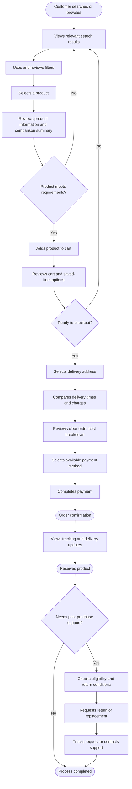

# Amazon India — Proposed TO-BE Process Flow

**Version:** 1.0  
**Prepared by:** Independent Business Analyst

## Purpose
This document presents a proposed version of the customer shopping journey based on observations from the AS-IS analysis. Suggestions focus on making some information easier to find and understand. They are independent recommendations and have not been approved or implemented by Amazon.

## Proposed improvements
- **Product discovery:** Make selected filters easier to review and modify.
- **Product evaluation:** Provide a clearer summary of important product information to help compare products.
- **Shopping cart:** Make Save for Later easier to locate, if it is not already sufficiently visible.
- **Delivery selection:** Compare delivery choices by estimated arrival, charges and available benefits.
- **Order tracking:** Make delivery updates and notification preferences easier to locate.
- **Returns:** Explain eligibility, deadlines, refund methods and pickup information clearly.

## Proposed process flow

## Expected benefits
| Proposed improvement | Expected benefit |
|---|---|
| Easier filter review | More convenient product discovery |
| Product information summary | Easier product comparison |
| Better Save for Later visibility | Easier cart management |
| Delivery comparison | Better delivery decisions |
| Clearer tracking updates | Better awareness of shipment progress |
| Clearer return information | Less uncertainty during returns |

## Limitations
Customer feedback has not been collected to validate these suggestions. No technical feasibility or cost assessment has been performed. This is not an official Amazon roadmap. Further validation is required.

**Status:** Proposed process — independent portfolio analysis.
